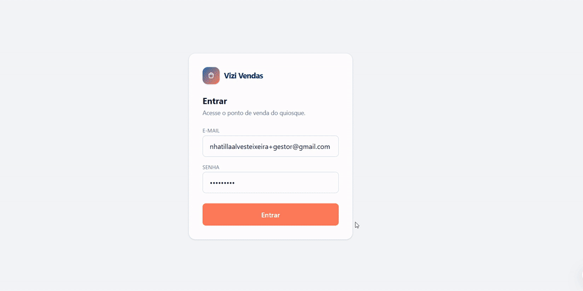

# Vizi Vendas

🔗 **Demo ao vivo:** [pdv.vizicrm.com.br](https://pdv.vizicrm.com.br)

## Demonstração



Vizi Vendas é um sistema de ponto de venda (PDV) para pequenos comércios —
vendas, estoque e caixa num único app, pensado para funcionar numa tablet
Android, direto no balcão da loja ou quiosque.

## Problema que resolve

Pequenos comércios — quiosques, lojas de bairro — costumam controlar
vendas e estoque de cabeça ou no papel: ninguém sabe ao certo o que vendeu
mais, quando o estoque de um produto está acabando, ou se o dinheiro do
caixa bate no fim do dia. O Vizi Vendas coloca venda, estoque e
fechamento de caixa num fluxo só, com números calculados automaticamente
em vez de contados na mão.

## Tecnologias utilizadas

* React + TypeScript
* Vite
* Tailwind CSS
* Supabase (banco de dados Postgres, autenticação e Row Level Security)
* Vercel
* PWA instalável (funciona como app, direto da tela inicial do tablet)
* Vitest

## Como executar o projeto

```bash
npm install
cp .env.example .env.local   # preencher com as chaves do seu projeto Supabase
npm run dev
```

O projeto sobe em `http://localhost:5173`. Pra conectar a um banco de
verdade, rode `supabase/schema.sql` no SQL Editor do Supabase.

Não existe cadastro público de contas: cada papel (gestor, funcionário,
dono) é uma conta criada manualmente no Supabase Dashboard
(Authentication > Users > Add user) — proposital, pensado pra um negócio
usar o sistema com a própria equipe, não pra qualquer visitante criar
conta sozinho.

## Funcionalidades atuais

* Três papéis com permissões bem separadas (reforçadas no banco via RLS, não só na tela):
  * **Gestor(a)**: cadastro de produtos (categoria, tamanho, preço, NF de origem), entrada e ajuste de estoque, histórico de movimentações, cancelamento de vendas
  * **Funcionário**: abrir caixa, vender (grade de produtos, carrinho, forma de pagamento), fechar caixa com cálculo automático de diferença
  * **Dono(a)**: resumo do dia (por forma de pagamento, funcionário, produtos mais vendidos) e auditoria completa de tudo que foi criado ou alterado — só leitura
* Estoque derivado só de movimentos (entrada, venda, ajuste, devolução por cancelamento) — nunca editado à mão
* Trilha de auditoria imutável: nenhum papel, nem gestor nem dono, consegue alterar ou apagar o rastro
* Alerta visível de estoque baixo
* Faixa de "período de demonstração" visível no topo, com data de expiração em horário local
* PWA instalável, otimizado pra tablet em modo paisagem
* Suíte de testes (Vitest) e verificação de permissões rodada de verdade contra o banco (`scripts/teste-rbac.js`), não só lida no código
* Hospedado na Vercel

## Próximas etapas

**Produto**
* Cadastro público com conta própria por negócio (hoje são só 4 contas fixas, compartilhando o mesmo ambiente — não escala pra múltiplos clientes ao mesmo tempo)
* Recuperação de senha pelo próprio app (hoje só reseta pelo Supabase Dashboard)
* Funcionamento com internet instável (fila de vendas com reenvio automático)
* Exportação do resumo e da auditoria em CSV/PDF
* Conexão com WhatsApp e carteiras móveis (M-Pesa, e-Mola) para pagamento

**Técnico / qualidade**
* Integração com maquininha de cartão (hoje a forma de pagamento é só um registro informativo)

## Documentação adicional

* [`PLAN.md`](./PLAN.md) — histórico de decisões técnicas do projeto
* [`ESCOPO_PILOTO.md`](./ESCOPO_PILOTO.md) — o que muda entre demo gratuita e piloto pago
* [`TESTE-MANUAL.md`](./TESTE-MANUAL.md) — roteiro de teste manual por papel
* [`RELATORIO-RBAC.md`](./RELATORIO-RBAC.md) — resultado da verificação de permissões rodada contra o banco real

## Autora

Natilla — [GitHub](https://github.com/nhatilla-integration)
